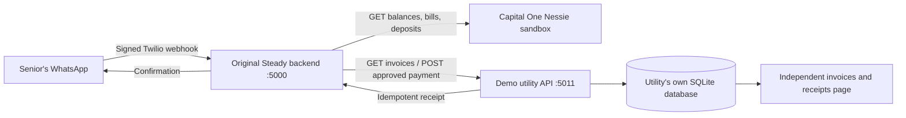

# External bill-payment simulation: handoff for Rishy

Use a **separate utility-company API with its own database and receipt page**.
The database stores obligations; the HTTP boundary lets Steady act outside its
own process; the page lets judges verify the provider actually received the
request. A second process on another port is enough for local testing, and the
same API can run on a different machine or behind an HTTPS tunnel.

This integration uses Rishy's original `b63af81` Flask/WhatsApp agent and its
original `python -m backend.app` entry point. It does not depend on the earlier
standalone `autopay_demo` or synthetic-data UI. Shared Git history is preserved;
there is no reset to an older commit and no force-push.



## What is real and what is simulated

| Part | Behavior |
| --- | --- |
| Twilio/OpenAI | Original integrations; Rishy supplies working credentials |
| Nessie | Actual sandbox reads used to plan and recheck available funds |
| Utility API | Real authenticated HTTP requests to a separate service |
| Invoice update/receipt | Persisted by that independent service, not Steady's database |
| Money movement | Simulated; no real utility is paid and Nessie is not debited |

The utility accepts fictional funds. The app maintains a local shadow budget
for accepted simulated payments so it cannot repeatedly spend an unchanged
Nessie balance. A receipt means **the demo utility accepted the simulation**,
not that Capital One transferred money. Both the phone copy and the provider
page label this explicitly. This contract can later sit behind a verified
Nessie executor, but no unverified bank write has been added here.

## Before pulling this change

The previous `rishy`/`andrew` update tracked `.env`. This change stops tracking
that file while keeping `.env.example`. **Save your existing local `.env`
before pulling**, because Git may remove a previously tracked copy. For example:

```sh
mkdir -p work
cp .env work/env-before-update
# Pull your team's chosen branch, then restore your private local settings:
cp work/env-before-update .env
chmod 600 .env work/env-before-update
```

Do not merge or add `.env` back to Git. Andrew's local settings were preserved
during integration. No branch history was rewritten.

## Run on Rishy's machine

Keep your existing Twilio/Nessie/OpenAI settings in `.env`, install the existing
requirements, and configure the integration:

```sh
python -m venv .venv
source .venv/bin/activate
python -m pip install -r requirements.txt
python -m scripts.biller_demo init
```

On Windows, activate with `.venv\Scripts\activate` instead. `init` preserves
existing account credentials and creates only missing biller configuration:

- `STEADY_EXTERNAL_BILLER=1` enables this optional path in the original server.
- `BILLER_BASE_URL=http://127.0.0.1:5011` selects the independent provider.
- `BILLER_API_TOKEN` authenticates the provider API.
- `STEADY_PAYMENT_CONTROL_TOKEN` protects Steady's operator endpoints.
- `STEADY_PAYMENT_DB` selects Steady's own queue/approval database.
- `STEADY_BILLER_DEMO_DATE` freezes the scheduler date for repeatable rehearsals.

The helper never prints keys. To view the utility page, copy the locally
generated `BILLER_API_TOKEN` from `.env` into its token field.

Terminal 1 — external utility company:

```sh
python -m biller_simulator
```

Open `http://127.0.0.1:5011`. It starts with three fictional invoices for
`demo-margaret`: Austin Energy $120 due in 3 days, Water Co $45.25 due in 5 days,
and Spectrum $89.99 due in 7 days. Amounts are stored as integer cents. Existing
provider databases retain their original invoices and receipts across restarts.

Terminal 2 — Rishy's original backend:

```sh
python -m backend.app
```

Terminal 3 — expose the **original backend on port 5000** to Twilio:

```sh
cloudflared tunnel --url http://127.0.0.1:5000
```

Set `PUBLIC_BASE_URL` to that exact HTTPS origin in `.env` and restart Terminal
2. Point the WhatsApp inbound webhook to
`https://<host>/whatsapp/inbound`, POST. The status callback remains
`https://<host>/whatsapp/status`, POST. Rishy's existing webhook-registration
helper and signature validation still apply.

## Caregiver approval

Every payment needs two approvals: the senior's reply to the exact proposal,
then the caregiver's decision by email. Set these in `.env`:

- `GMAIL_ADDRESS` and `GMAIL_APP_PASSWORD`: the Gmail account that sends the
  request, using a Google app password (spaces are ignored).
- `CAREGIVER_EMAIL`, and optionally `CAREGIVER_NAME` for the senior's messages.
- `STEADY_APPROVAL_BASE_URL`: the origin the email links open. It defaults to
  `PUBLIC_BASE_URL`, then `http://127.0.0.1:5000` (works only on this machine).
  Use the tunnel origin so the caregiver can approve from a phone.

The email and the approval page show only payee, amount, and payment date,
never the balance, deposits, or cushion. Opening a link only shows the request;
Approve and Deny are buttons (POST), so mail scanners that prefetch links cannot
decide. Each request has its own random link, stored only as a hash.

| Situation | Result |
| --- | --- |
| Senior says YES | Caregiver is emailed; senior hears approval is pending |
| Caregiver approves on or before the planned date | Payment runs on that date after a fresh funds check |
| Caregiver denies | Nothing is paid; senior is told |
| Caregiver never answers | Stays pending; senior is reminded on the planned date; expires after the due date |
| Caregiver approves after the planned date | Held; nothing is paid |
| Senior says NO before submission | Cancelled, even while the caregiver is deciding |
| Email fails 5 times | Senior is told it is on hold; nothing is paid |

## Demo script

1. Open the external utility page: all invoices start **unpaid**.
2. From the configured senior's joined WhatsApp phone, text **HI** to open the
   session. This is rehearsal preparation, not payment consent.
3. Within the monitor's ten-second polling interval, Steady reads the utility
   invoices and Nessie funds, then sends the proposal, for example: “Your
   $120.00 Austin Energy bill is due Wednesday, Oct 28. I recommend paying it
   today, so you keep at least $200.00 in your account. Would you like me to
   schedule it? Reply YES or NO.” When a pending deposit is what makes a later
   date safe, it says “after your deposit arrives”.
4. Reply **YES**. A bare yes counts only when exactly one proposal is waiting;
   **YES ABCD1234** with the reference always works. Forwarded text or extra
   words cannot choose a payment.
5. The caregiver receives the approval email. Click **Approve**, then press the
   **Approve** button on the page that opens.
6. If the proposed date is today, execution happens right after approval.
   Otherwise it runs when the scheduler reaches the agreed date.
7. Watch the **separate utility page** change Austin Energy to **paid** and
   display its receipt. Steady confirms with that same receipt id.
8. Retry the same reply or approval. The utility still has one payment and one receipt.
9. Ask “What bills do I have?” The agent reads the external utility's statuses
   in this mode and labels them as simulation records. Balance/deposit questions
   continue using Nessie, whose balance is unchanged by simulated settlement.

With a starting Nessie balance near the existing Margaret seed's $2,213, the
small known bill normally proposes today. Planning chooses the earliest safe
date, rather than delaying a safe payment merely for theatrics. The three-day
deadline explains why monitoring reached out. A delayed-income test below
demonstrates an actual scheduled future execution.

## Operate and inspect

```sh
python -m scripts.biller_demo status
python -m scripts.biller_demo check
python -m scripts.biller_demo advance --days 1
python -m scripts.biller_demo receipts
```

`check` and the background poller use the same code. `advance` is available only
with a frozen demo date, advances one day at a time, and runs scheduled checks.
It does **not** credit a pending Nessie deposit: fresh Nessie balance must show
settled funds or execution is held. Pending income can inform future planning,
but same-day pending income is never treated as cleared cash.

To cancel, reply **NO** or **CANCEL** (add the reference if more than one
payment is open) any time before submission. A request already sent with an uncertain outcome stays in
reconciliation; cancel cannot falsely promise that an accepted payment vanished.

For a fresh demo cycle, use a new `--db` for the utility service and a new
`STEADY_PAYMENT_DB` for Steady. Provider invoice ids are unique per fresh seed,
so an old approval cannot pay a newly seeded invoice. Restarting either service
without changing databases preserves state rather than silently resetting it.

## Make the utility genuinely remote

Run `python -m biller_simulator` on another machine and put an HTTPS tunnel or
hosting reverse proxy in front of port 5011. Set Steady's `BILLER_BASE_URL` to
that HTTPS origin and give both services the same `BILLER_API_TOKEN`. Restart
Steady. No provider database files are shared or mounted into the agent.

The client permits plain HTTP only on loopback and never forwards its bearer
token through a redirect. The provider HTML has no embedded secret and uses
authenticated API reads. Its page is evidence of provider state, not a payment
form or a real utility site. Keep the demo token on your authorized test systems.

## Notifications and safety

- All decisions still enter through Twilio's validated signature and the
  configured senior phone. Payment mode ignores `ALLOW_ANY_SENDER` and requires
  a nonempty MessageSid. Only a literal YES/NO (with a reference, or bare when
  exactly one decision is open) that agrees with the model's intent label is
  actionable; the model cannot invent payees, amounts, dates, or invoke payment URLs.
- The complete read-back must be sent before consent. Consent expires after
  the next simulated date or the deadline, whichever comes first.
- The $200 buffer is checked at planning and again immediately before HTTP
  submission. Other known obligations are reserved; exact matching bank/biller
  bill triples are deduplicated. Forecast horizon is capped at 90 days and does
  not invent unlisted future spending.
- New payees and amounts above $5,000 are held. Every other payment still needs
  the caregiver's emailed approval; a senior yes alone never pays.
- Outside an open WhatsApp session, the full read-back stays queued. Optional
  `BILLER_WAKE_TEMPLATE_SID` must be an approved **no-variable generic invitation
  to reply HI**, not the existing appointment template. Without it, send HI
  during setup. No generic wake-up counts as consent.
- Notifications are at-least-once: a crash around a send can duplicate a text.
  Payment idempotency is independent of message delivery.
- Each approved job has one durable provider idempotency key. The provider
  commits invoice completion and receipt atomically. Before submission or retry,
  Steady looks up that key. A lost response or process crash therefore recovers
  the original receipt instead of issuing a new payment identity.
- If the provider cannot be reached, the job remains `reconciling`; Steady
  never says paid without a matching receipt. Changed invoice details or an
  unsafe fresh balance hold the job rather than silently changing consent.
- No real bank debit exists here. This is an executable integration boundary
  for the team's money-brain owner to connect to verified sandbox banking writes.

## API contract

All `/v1/` calls require `Authorization: Bearer <BILLER_API_TOKEN>`.

| Call | Result |
| --- | --- |
| `GET /v1/invoices?customer_ref=demo-margaret` | Invoice ids, amounts in cents, currency, payee, version, due date, status |
| `GET /v1/invoices/<id>` | Fresh invoice |
| `POST /v1/payments` | Atomically marks one invoice paid and returns its receipt |
| `GET /v1/payments/<idempotency-key>` | Existing receipt, or 404 if never accepted |
| `GET /v1/payments` | Independent provider receipts for the judge's page |

POST requires `Idempotency-Key` and exactly:
`invoice_id`, `customer_ref`, `amount_cents`, `currency`, `invoice_version`,
`due_date`, `simulation_date`. Amount, customer, version, currency, and deadline
must match the current invoice. Reusing a key with different fields, or paying
an already paid invoice using another key, returns 409.

Steady's `/demo/payments`, `/demo/payments/check`, and `/demo/payments/advance`
operator endpoints require the separate `STEADY_PAYMENT_CONTROL_TOKEN`.

## Tests Rishy can run without keys

```sh
python -m pytest tests/test_external_biller.py -q
python -m pytest -q
```

The integration suite launches the utility as a **separate OS process** on an
ephemeral port and exercises real HTTP requests. Twilio, the language model,
and Nessie responses are controlled test doubles. It verifies the original
signed webhook, independent invoice updates, exact consent, unknown/large-payee
holds, funds rechecks, pending income, cancellation, immutable invoice versions,
budget reservation, persistent provider idempotency, timeout reconciliation, and
recovery when the provider accepted before Steady could persist its result.

The remaining manual check is Rishy's real WhatsApp/Nessie/OpenAI environment.
No live WhatsApp messages, real bank writes, or real utility payments were sent
while implementing this change.
