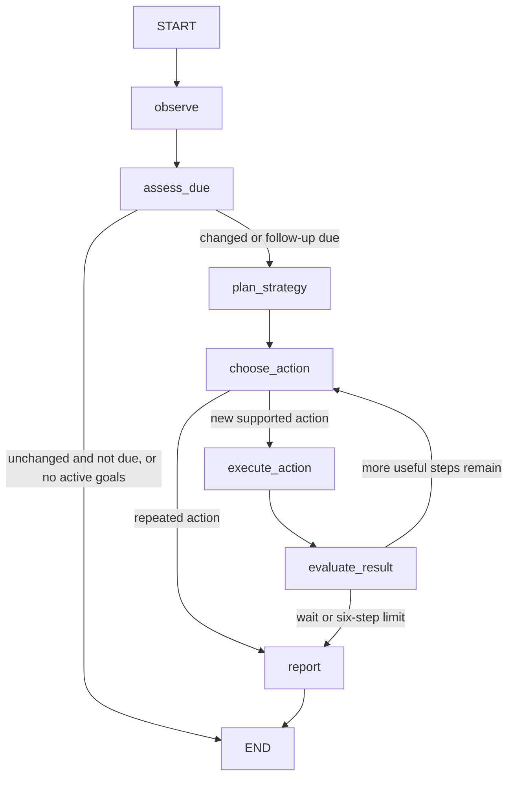

# Checkpointed goal planning

Steady uses LangGraph for the goal-planning loop. The existing OpenAI SDK wrapper,
structured model responses, financial calculations, simulated ledger, Slack
transport and payment approvals remain in their original services. There is no
new LangChain agent/model layer. LangGraph installs `langchain-core` transitively.

## Nodes and transitions

`backend/autonomy/graph.py` defines the graph. `Controller.run()` still acquires
the shared lock and SQLite lease, handles sanitized errors and schedules retries.
The worker still checks every 60 seconds; inbound conversation turns can also
trigger a check. Unchanged facts do not cause another model call before follow-up.

`plan_strategy` calls the existing validated adaptive planner only for confirmed
adaptive plans. `choose_action` calls the existing OpenAI wrapper with a narrowed
tool schema. `execute_action` invokes the existing controller tool dispatcher.
Financial services remain authoritative about amounts, receipts and approvals.
`report` guarantees coverage of active budgets and deduplicated progress messages.

## Explicit graph state

| Field | Meaning |
| --- | --- |
| `cycle_id` | Identifier for a bounded planning cycle |
| `snapshot`, `active` | Observed financial facts and active goals |
| `fingerprint` | Input facts used for scheduled-work deduplication |
| `observed_revision` | Facts/authority at the latest completed node |
| `action`, `available` | Selected action and the permitted tools |
| `results`, `used` | Actual tool results and actions already attempted |
| `steps`, `stop`, `due`, `force` | Bounds and routing decisions |

The checkpointer path is derived from the existing goal-memory path: for
`goals.sqlite`, it is `goals.checkpoints.sqlite`. A stable hashed household
`thread_id` identifies the execution history. Each invocation resets cycle-local
fields. The SQLite connection is scoped to the invocation and closed afterward;
the process does not retain an open database connection per controller instance.
Checkpoint writes use synchronous durability at node boundaries.

The existing databases retain their roles: account/pot balances and allocation
receipts in the account ledger, goal/intake/outbox data in goal memory, and
approvals/payment receipts in the payment ledger. Graph state is execution
progress, not a replacement financial ledger.

## Restart behavior

1. The controller loads the latest checkpoint before starting another cycle.
2. If a node is pending, it refreshes finances and active goal authority.
3. If these still match the checkpoint, it respects retry timing and resumes the
   pending node. Completed nodes and saved action selection are not rerun.
4. If finances or authority changed, it supersedes the pending path and starts a
   fresh observation/planning cycle. This covers new expenses, paused/replaced
   policies, account or simulation resets, changed bills and approvals.
5. If allocation committed but the node did not checkpoint, the changed ledger
   causes a fresh assessment. Existing per-deposit credits prevent duplicate
   savings allocations. Checkpoints alone are not an exactly-once money guarantee.

Strategy timestamps and wording are excluded from financial revision checks so
the model cannot create a self-triggering replanning loop. Actual goal progress
and cash changes do trigger reassessment. A model outage leaves the failed node
pending and preserves the durable retry time on unchanged facts.

Payment execution/approval is deliberately outside this graph migration. A
`resolve_bill` action may request reconsideration of a funds-held invoice; the
payment service still requires fresh user and caregiver approval. There is no
graph action that bypasses those approvals.

## Verification

Run `python -m pytest tests/test_goal_graph.py`. Tests use real on-disk SQLite
checkpoints and reconstruct the controller/checkpointer to exercise restart:

- Stop before execution; resume the saved action without another model selection.
- Stop after checkpointed allocation; resume evaluation without repeating debit.
- Crash after ledger commit but before node completion; refresh and avoid replay.
- Pause a policy or post a large expense while an action is pending; invalidate it.
- Inspect graph nodes, checkpoint history and persisted structured tool results.

Existing autonomy, adaptive strategy, payment, signed Slack and budgeting tests
continue to run through the new graph. No special fake graph replaces LangGraph.

## Hosting limits

Checkpoint recovery requires the database files to survive the restart. Free
Render's ephemeral filesystem can be lost on deployment; this change does not
provide durable storage across those deployments or keep a sleeping service
running. Keep a single hosted process/instance as before. Production hardening
would include checkpoint retention and durable managed storage.
