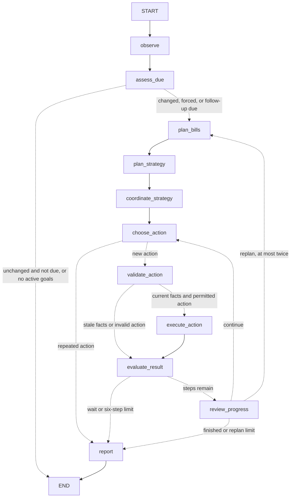

# Checkpointed goal planning

Steady uses LangGraph for the goal-planning loop. The existing OpenAI SDK wrapper,
structured model responses, financial calculations, simulated ledger, Slack
transport and payment approvals remain in their original services. There is no
new LangChain agent/model layer. LangGraph installs `langchain-core` transitively.

## Nodes and transitions

`backend/autonomy/graph.py` defines the graph. `Controller.run()` still acquires
the shared lock and SQLite lease, handles sanitized errors and schedules retries.
The worker still checks every 60 seconds; inbound conversation turns can also
trigger a check. Unchanged facts do not cause another model call before follow-up.

Solid edges above are unconditional. Dashed edges are Python checks on graph
state. More nodes do not create more OS threads or independently spending agents.

| Node | Responsibility |
| --- | --- |
| `observe` | Fresh account facts and active user/bill goals |
| `assess_due` | Decide whether changed facts, forced work or a follow-up warrant reasoning |
| `plan_bills` | A dedicated LLM ranks unpaid invoices and selects dates from Python-calculated candidates |
| `plan_strategy` | Budget-domain analysis: adaptive goal priorities/caps, or the confirmed fixed plan/dated forecast |
| `coordinate_strategy` | Reconcile bill and budget proposals; restrict savings when obligations or payment outcomes need review |
| `choose_action` | Select one tool using both proposals, their coordination, and actual prior results |
| `validate_action` | Refresh facts and check tool availability and identifiers before execution |
| `execute_action` | Invoke the existing deterministic controller tool dispatcher |
| `evaluate_result` | Enforce wait and action-count limits |
| `review_progress` | Review money-action outcomes/errors with the model and choose continue, replan or report |
| `report` | Queue current budget/progress reports and retain follow-up timing |

Bill analysis uses `steady_bill_strategy`; cross-goal coordination uses
`steady_coordinate_strategy`; substantive outcome review uses
`steady_review_progress`. Prompts and response validation are in
`backend/autonomy/planning.py`. The existing adaptive budget prompt remains in
`backend/simulation/strategy.py` and now receives the bill proposal explicitly.
The tool prompt receives separate `bill_strategy`, `budget_strategy`, and
`coordination` objects; it does not have to reconstruct their purpose from events.

Each bill candidate date reserves all known unpaid obligations, the cushion and
essentials. Candidate dates are checked together after model selection, so a
set of individually safe early payments cannot overdraw the combined forecast.
New or funds-held bills can use the selected date and outreach order; existing
approved/cancelled/denied/user-held/uncertain jobs remain unchanged. Preferences
are bound to the account, date, invoice version, amount, payee and deadline, and
are safety-checked again when a proposal is made. A now-unsafe selected date
holds for reassessment instead of silently choosing a different date.

`plan_bills` saves a proposal; only successful coordination publishes the bill
strategy for the payment service. No plan creates payment consent. If no safe
combination exists, the controller asks for review and blocks new savings; it
does not silently skip a bill, assume a grace period, or promise negotiations.
Savings eligibility no longer forces an allocation-only tool menu: the agent
can inspect a bill first. Fixed percentages still require explicit adaptive
authority before the budget planner can redistribute them.

Each run permits at most six action attempts (including rejected choices) and
two returns to specialist planning. Ordinary observation tools continue directly;
the separate outcome review reasons about committed savings, bill replanning
and errors. Nodes renew the exclusive SQLite lease so a longer reasoning run
does not outlive its claim. Financial services remain authoritative about every
amount, reservation, approval and receipt.

## Explicit graph state

| Field | Meaning |
| --- | --- |
| `cycle_id` | Identifier for a bounded planning cycle |
| `architecture_version` | Invalidates pending checkpoints from the earlier graph layout |
| `snapshot`, `active` | Observed financial facts and active goals |
| `fingerprint` | Input facts used for scheduled-work deduplication |
| `observed_revision` | Facts/authority at the latest completed node |
| `action`, `available` | Selected action and the permitted tools |
| `bill_strategy`, `budget_strategy` | Distinct validated domain proposals |
| `coordination` | Shared focus, savings permission and detected blockers |
| `valid_action`, `needs_replan` | Whether execution can proceed on current facts |
| `review`, `replans` | Outcome-review route and bounded replanning count |
| `results`, `used` | Actual tool results and actions already attempted |
| `steps`, `stop`, `due`, `force` | Bounds and routing decisions |

The checkpointer path is derived from the existing goal-memory path: for
`goals.sqlite`, it is `goals.checkpoints.sqlite`. A stable hashed household
`thread_id` identifies the execution history. Each invocation resets cycle-local
fields. The SQLite connection is scoped to the invocation and closed afterward;
the process does not retain an open database connection per controller instance.
Checkpoint writes use synchronous durability at node boundaries.

The existing databases retain their roles: account/pot balances and allocation
receipts in the account ledger, goal/intake/outbox data in goal memory, and
approvals/payment receipts in the payment ledger. Graph state is execution
progress, not a replacement financial ledger.

## Restart behavior

1. The controller loads the latest checkpoint before starting another cycle.
2. If a node is pending, it refreshes finances and active goal authority.
3. If these still match the checkpoint, it resumes the pending node immediately
   when no node error is recorded. Failed nodes respect the stored retry timing.
   Completed nodes and saved action selection are not rerun.
4. If finances, authority or graph architecture changed, it supersedes the pending path and starts a
   fresh observation/planning cycle. This covers new expenses, paused/replaced
   policies, account or simulation resets, changed bills and approvals.
5. If allocation committed but the node did not checkpoint, the changed ledger
   causes a fresh assessment. Existing per-deposit credits prevent duplicate
   savings allocations. Checkpoints alone are not an exactly-once money guarantee.

Strategy timestamps and wording are excluded from financial revision checks so
the model cannot create a self-triggering replanning loop. Actual goal progress
and cash changes do trigger reassessment. A model outage leaves the failed node
pending and preserves the durable retry time on unchanged facts.

Payment execution/approval is deliberately outside this graph migration. A
`resolve_bill` action may request reconsideration of a funds-held invoice; the
payment service still requires fresh user and caregiver approval. There is no
graph action that bypasses those approvals.

## Verification

Run `python -m pytest tests/test_goal_graph.py tests/test_coordinated_planning.py`. Tests use real on-disk SQLite
checkpoints and reconstruct the controller/checkpointer to exercise restart:

- Stop before execution; resume the saved action without another model selection.
- Stop after checkpointed allocation; resume evaluation without repeating debit.
- Crash after ledger commit but before node completion; refresh and avoid replay.
- Pause a policy or post a large expense while an action is pending; invalidate it.
- Inspect graph nodes, checkpoint history and persisted structured tool results.
- Model-selected dates and priority order affect proposals without granting consent.
- Compare individual versus joint date safety; reject unsupported model dates/ids.
- Prevent savings despite an optimistic coordinator when a bill remains uncovered.
- Re-enter specialist planning after measured progress, within the cycle limits.

Existing autonomy, adaptive strategy, payment, signed Slack and budgeting tests
continue to run through the new graph. No special fake graph replaces LangGraph.

## Hosting limits

Checkpoint recovery requires the database files to survive the restart. Free
Render's ephemeral filesystem can be lost on deployment; this change does not
provide durable storage across those deployments or keep a sleeping service
running. Keep a single hosted process/instance as before. Production hardening
would include checkpoint retention and durable managed storage.
